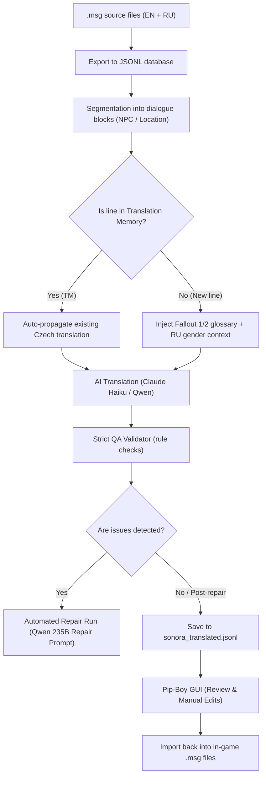

# Fallout: Sonora CZ – AI Localization Pipeline & Pip-Boy GUI

[Česká verze dokumentace (Czech version)](README_CZ.md)

> [!NOTE]
> **Project Status: Open Community Archive / Work-in-Progress**  
> This project was developed as a semi-automated localization, quality assurance, and repair toolkit for the total conversion mod **Fallout: Sonora**. Active development was archived after the **RetroGameplay CZ** team released a full Czech localization on [Lokalizace.net](https://lokalizace.net).
> 
> **AI Authorship Disclosure:**  
> The entire codebase, Pip-Boy web interface, validation rule engine, and translation pipelines in this repository were **generated and developed exclusively using AI** (pair programming via AI coding assistant). It is released to the community as a free open-source resource for modders and translators.

> [!WARNING]
> **Disclaimer: The system is imperfect, experimental, and unfinished**  
> This entire toolkit was built iteratively as an experimental semi-automated pipeline. **It is by no means 100% polished, flawless, or bug-free:**
> - **AI Inaccuracies & Hallucinations:** While the QA validator catches known issues (abbreviations, Cyrillic leaks, grammatical gender hints), LLMs still occasionally hallucinate, introduce awkward phrasing, or misinterpret dialogue nuances.
> - **Unfinished Proofreading:** The translated lines have not undergone exhaustive human review. Hundreds of flagged QA warnings remain in the database.
> - **Development Scripts:** Some helper scripts were tailored to the author's local Windows setup and are in a scratch/work-in-progress state.
> 
> Please treat these tools and datasets as an experimental foundation and source of inspiration, not as a finished commercial product.

---

## 💡 How the System Works

Translating games built on the classic Fallout 2 engine is uniquely challenging: *Fallout: Sonora* contains over **116,000 lines of text** across hundreds of `.msg` files. Generic machine translation fails due to lack of grammatical gender in English (which must be inferred from the Russian source), syntax corruption in dialogue scripts, broken mechanics abbreviations, and loss of atmospheric Mexican/Spanish slang.

This toolkit combines **AI models (Claude 3 Haiku, Qwen 235B via OpenRouter / Ollama)**, **Translation Memory**, **strict QA regex validators**, and a **lightweight local Pip-Boy web GUI**.



---

## 🏛️ Preservation of Classic Fallout 1 & 2 Czech Translations

A fundamental guiding principle of this project was **deep respect for the legacy of the original Czech fan translators of Fallout 1 and Fallout 2**. 

Rather than re-inventing terms or relying on generic modern machine vocabulary, our pipeline actively prioritized:
* **Canonical Terminology:** Strictly aligning names of weapons, armor, items, perks, skills, traits, and SPECIAL stats with the classic Czech translations established in Fallout 1 and 2.
* **Atmospheric Slang & Tone:** Preserving the dry, gritty, dark, and post-apocalyptic humor and phrasing characteristic of the original Czech localizations.
* **Consistency:** Forcing the AI models to adhere to pre-compiled TSV dictionaries extracted directly from the original Czech Fallout 1/2 dialogue and game files.

---

## 🛠️ Key System Components

### 1. Pip-Boy Web GUI (`translation_server.py` + `05_scripts/gui/index.html`)
* **Pure Python Backend:** Runs locally on port 8000 using Python's built-in `http.server` (zero external dependencies like Node or heavy frameworks).
* **Location & Category Filtering:** Quickly filter rows by location (AC, FC, DC, RC...), file category (dialogue, NPC, scenery, items, combat, perks), or QA error status.
* **Interactive Editor:** Displays the EN source, RU reference with **color-coded grammatical gender (♂ Blue / ♀ Pink)**, dialogue context, and one-click term suggestions from the glossaries.
* **Live Pipeline Console:** Launch translations, batch repairs, or game file exports directly from the browser with real-time logs and auto-reloading.

### 2. Glossaries & Style Rules (`03_glossary/`)
* **Fallout 1 & 2 Canonical Alignment:** Pre-aligned term bases for items, perks, skills, and locations from classic Czech Fallout localizations.
* **Protected Terms:** Preserves character names and mod terminology (*Vault City*, *New Reno*, preventing *Cesareo* from being translated into *Caesar*).
* **Spanish Flavor Preservation:** Strict rules preventing AI from translating Sonora's Mexican slang (*amigo, compañero, señor, No hablo inglés* stay Spanish).

### 3. Hard QA Validator (`check_row_issues`)
Automatically scans translated lines for typical AI translation artifacts:
* **Cyrillic Leaks & Anglicisms:** Catches unintended Russian characters or untranslated English remnants.
* **Mechanics Abbreviations:** Enforces canonical Fallout stats: **AP** (Action Points, not *AB/AK*), **HP** (Hit Points, not *BZ*), **XP** (not *ZB*), and **AC** (Armor Class, not *OČ*).
* **Player Addressing:** Strictly enforces informal second-person singular (*Vidíš* instead of formal *Vidíte*).
* **CAPS Preservation:** If the English source uses ALL CAPS warnings (*DANGER*, *WARNING*, *STOP*), the Czech translation must retain capital letters.

### 4. Automated AI Repair Loop (`repair_cmd`)
* Filters out rows with failed QA checks.
* Sends them in batches to a stronger model (e.g. `qwen/qwen3-235b-a22b-2507`) with explicit repair instructions and violation notes.
* Successfully repaired lines are tagged with `"repaired": true`.

---

## ⚠️ Completed Features vs. Work-in-Progress State

| Component | Status | Notes |
| :--- | :---: | :--- |
| **.msg Exporter & Importer** | ✅ 100% Complete | Flawless two-way conversion without corrupting game syntax |
| **Pip-Boy GUI & Local Server** | ✅ 100% Complete | Full search, filtering, live editor, and pipeline controls |
| **Glossary & QA Rules Engine** | ✅ 100% Complete | Synchronized across server, CLI pipeline, and browser UI |
| **Automated AI Repair Loop** | ✅ 100% Complete | Reliably fixes formatting and terminology bugs |
| **Full Sonora Translation** | ⚠️ ~12% Done | ~13,520 of 116,384 rows have draft translations in `sonora_translated.jsonl` |
| **Manual Human Proofreading** | ⚠️ Incomplete | ~325 QA warnings remain flagged for review |

---

## 🚀 Quick Start Guide

### Prerequisites
* Python 3.10 or newer (tested on Python 3.14 on Windows).
* Optional: [OpenRouter API Key](https://openrouter.ai/) for Claude / Qwen models (or a local Ollama instance).

### Running the Web GUI
1. Clone the repository:
   ```bash
   git clone https://github.com/Kouputrax/fallout-sonora-cz.git
   cd fallout-sonora-cz
   ```
2. Install minimal dependencies:
   ```bash
   pip install -r requirements.txt
   ```
3. Start the server:
   * On Windows, double-click `start_server.bat` (or run `python 05_scripts/translation_server.py`).
4. Open in your browser:
   **[http://localhost:8000](http://localhost:8000)**
5. Click the ⚙️ Settings icon in the top-right to configure your API key or model.

---

## 📂 Repository Structure

```text
├── 02_work/
│   └── translated/
│       └── sonora_translated.jsonl    # Main translation database (116,384 rows, ~41 MB)
├── 03_glossary/                       # TSV glossaries from Fallout 1/2 and style guides
├── 04_prompts/                        # System prompts for translation and repair
├── 05_scripts/
│   ├── gui/
│   │   └── index.html                 # Complete Pip-Boy web interface
│   ├── sonora_msg_pipeline.py         # Main CLI tool (export, translate, validate, repair, import)
│   ├── translation_server.py          # Lightweight REST HTTP server
│   ├── translate_blocks.py            # Dialogue block segmenter with Translation Memory
│   └── ...                            # Benchmark and utility scripts
├── README.md                          # English documentation (this file)
├── README_CZ.md                       # Czech documentation
├── requirements.txt                   # Minimal dependencies
└── start_server.bat                   # One-click Windows launcher
```

---

## 🤝 Credits & Acknowledgments
* **Original Czech Translators of Fallout 1 & 2** for creating the iconic, atmospheric Czech terminology and post-apocalyptic slang that we all grew up with.
* **Nevada Band Studio** for creating the amazing *Fallout: Sonora* mod.
* **RetroGameplay CZ** for completing and releasing the full Czech translation on [Lokalizace.net](https://lokalizace.net).
* Released under the MIT / Public Domain license for the classic Fallout modding community.
