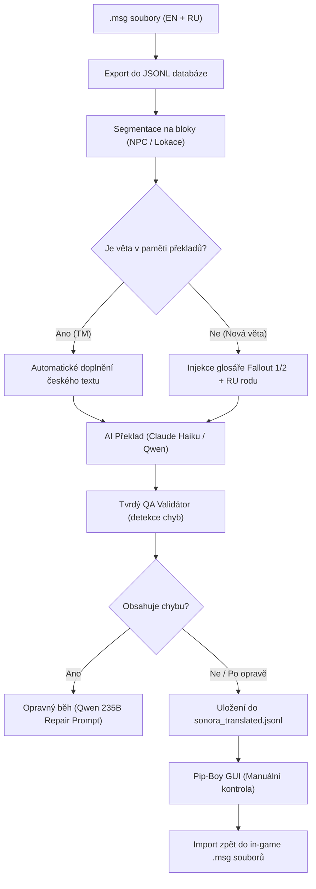

# Fallout: Sonora CZ – AI Lokalizační Pipeline & Pip-Boy GUI

[English version of documentation](README.md)

> [!NOTE]
> **Stav projektu: Otevřený komunitní archiv / Nedokončený (Work-in-Progress)**  
> Tento projekt vznikl jako poloautomatický překladový a validační nástroj pro totální konverzi **Fallout: Sonora**. Projekt byl pozastaven poté, co skupina **RetroGameplay CZ** vydala kompletní českou lokalizaci na portálu [Lokalizace.net](https://lokalizace.net).
> 
> **Upozornění o autorství AI:**  
> Veškerý kód, skripty, webové rozhraní Pip-Boy, validační pravidla i překladové procedury v tomto repozitáři byly **vytvořeny a vygenerovány výhradně pomocí umělé inteligence (AI)** v režimu párového programování s AI asistentem. Projekt je předán komunitě jako volně dostupný open-source materiál.

> [!WARNING]
> **Důležité upozornění: Celý systém je experimentální, nedotažený a obsahuje chyby**  
> Tento toolkit vznikal postupně jako experimentální poloautomatický pipeline vyvíjený za běhu. **Není v žádném případě 100% dokonalý ani bezchybný:**
> - **AI halucinace a stylistické výkyvy:** Ačkoliv validátor hlídá známé neduhy (zkratky, rody, azbuku), AI modely občas vygenerují nepřesné obraty, gramatické chyby nebo přehlédnou jemný kontext dialogu.
> - **Nedokončená lidská revize:** Přeložené části neprošly kompletní lidskou korekturou. V databázi zůstávají stovky otevřených QA varování.
> - **Pracovní stav skriptů:** Některé pomocné skripty byly laděny na míru lokálnímu prostředí autora na Windows a mají charakter nedokončených pracovních nástrojů.
> 
> Všechny nástroje i data berte prosím jako otevřený experimentální základ pro další práci a inspiraci, nikoliv jako hotový komerční produkt.

---

## 💡 O co v projektu šlo a jak systém funguje

Překlad her na enginu Falloutu 2 je extrémně náročný: Sonora obsahuje přes **116 000 řádků textu** rozesetých v desítkách `.msg` souborů. Běžné strojové překladače selhávají na gramatických rodech (v angličtině chybí rod, který je nutné dovodit z ruštiny), ničí herní formátování, kazí zavedenou terminologii a počešťují španělské atmosférotvorné výrazy.

Tento toolkit proto kombinuje **AI modely (Claude 3 Haiku, Qwen 235B)**, **Translation Memory**, **přísná QA pravidla** a **lokální webové rozhraní stylizované do Pip-Boye**.



---

## 🏛️ Zachování odkazu původních překladů Falloutu 1 a 2

Zásadním pilířem celého projektu byla **maximální úcta a snaha o zachování práce původních překladatelů klasických dílů Fallout 1 a 2 do češtiny**.

Místo vymýšlení nových pojmů nebo spoléhání se na generický moderní slovník náš systém aktivně dbal na:
* **Kanonickou terminologii:** Striktní sjednocení názvů zbraní, brnění, předmětů, perků, dovedností, vlastností a SPECIAL statistik podle legendárních českých překladů Falloutu 1 a 2.
* **Atmosférický slang a tón:** Zachování suchého, drsného, černého a postapokalyptického humoru a mluvy, které jsou pro klasickou českou lokalizaci typické.
* **Konzistenci:** Vymáhání předem sestavených TSV glosářů vytěžených přímo z původních českých herních databází a dialogů.

---

## 🛠️ Klíčové komponenty systému

### 1. Pip-Boy Webové rozhraní (`translation_server.py` + `05_scripts/gui/index.html`)
* **Čistý Python server:** Běží na portu 8000 přes standardní `http.server` (žádné složité závislosti jako Flask nebo Node.js).
* **Filtrování a vyhledávání:** Filtrování podle lokací (AC, FC, DC...), kategorií (dialogy, NPC, scenery, předměty, perky...), stavu překladu i přítomnosti QA chyb.
* **Živý editor:** Zobrazuje EN originál, RU referenci s **barevným rozlišením rodu (♂ modře / ♀ růžově)**, kontext okolního rozhovoru postavy a interaktivní našeptávač z glosářů na jedno kliknutí.
* **Konzole a ovládání pipeline:** Spouštění překladů, opravných běhů i exportů přímo z prohlížeče se sledováním průběhu v reálném čase.

### 2. Glosáře a styl (`03_glossary/`)
* **Provázání s Fallout 1 a 2:** Desítky TSV souborů se sjednocenými pojmy předmětů, perků, dovedností a lokací.
* **Chráněné pojmy (Protected Terms):** Ochrana vlastních jmen a mechanik (např. *Vault City*, *New Reno*, postava *Cesareo* nesmí být překládána jako *Caesar* apod.).
* **Pravidlo pro španělštinu:** Zachování španělského nádechu v Sonoře (*amigo, compañero, señor, No hablo inglés* se nepřekládají do češtiny).

### 3. Tvrdý QA Validátor (`check_row_issues`)
Kontroluje text na desítky specifických chyb, které AI generuje:
* **Zbytky azbuky a anglicismy:** Odhalí nechtěná ruská písmena nebo nepřeložená slova.
* **Správné Fallout zkratky:** Hlídá používání klasických zkratek: **AP** (ne *AB/AK*), **HP** (ne *BZ*), **XP** (ne *ZB*), **AC** (ne *OČ*).
* **Styl tykání/vykání:** Zakazuje neosobní vykání hráči (*Vidíte* ➔ *Vidíš*).
* **Nezaměňování jazyků:** Zamezuje chybám typu *Spanish* přeloženo jako *česky*.
* **Zachování VELKÝCH PÍSMEN (CAPS):** Pokud má originál varování celá velkými písmeny (*DANGER*, *WARNING*), hlídá velká písmena i v češtině.

### 4. Automatický opravný běh (Repair Loop)
* Vezme pouze řádky, na kterých selhal validátor.
* Pošle je silnějšímu modelu (např. `qwen/qwen3-235b-a22b-2507`) spolu s přesným výčtem toho, co je špatně.
* Úspěšně opravené řádky označí příznakem `"repaired": true`.

---

## ⚠️ Co je hotové a co zůstalo nedokončené

| Funkcionalita | Stav | Poznámka |
| :--- | :---: | :--- |
| **Export a import .msg souborů** | ✅ 100% | Plně funkční obousměrný převod bez poškození formátu hry |
| **Pip-Boy GUI & Lokální Server** | ✅ 100% | Funkční vyhledávání, filtry, editor, kontext i ovládání pipeline |
| **Glosáře a validační pravidla** | ✅ 100% | Kompletní pravidla synchronizovaná mezi serverem, pipeline i GUI |
| **Automatický opravný běh (Repair)** | ✅ 100% | Schopen autonomně opravovat detekované QA nesrovnalosti |
| **Celkový překlad Sonory** | ⚠️ ~12% | V databázi `sonora_translated.jsonl` je přeloženo cca 13 520 řádků z 116 384 |
| **Manuální revize textů** | ⚠️ Nedokončeno | Zůstává cca 325 hlášených QA varování k manuálnímu posouzení |

---

## 🚀 Jak systém zprovoznit (Rychlý start)

### Požadavky
* Python 3.10 nebo novější (testováno na Python 3.14 na Windows).
* Volitelně API klíč na [OpenRouter](https://openrouter.ai/) (pro Claude 3 Haiku nebo Qwen modely). Lze použít i lokální Ollamu.

### Spuštění webového rozhraní
1. Naklonujte nebo stáhněte tento repozitář:
   ```bash
   git clone https://github.com/Kouputrax/fallout-sonora-cz.git
   cd fallout-sonora-cz
   ```
2. Nainstalujte základní knihovny:
   ```bash
   pip install -r requirements.txt
   ```
3. Spusťte server:
   * Ve Windows poklepáním na `start_server.bat` (nebo příkazem `python 05_scripts/translation_server.py`).
4. Otevřete v prohlížeči:
   **[http://localhost:8000](http://localhost:8000)**

5. V nastavení GUI (ikona ⚙️ vpravo nahoře) můžete zadat svůj OpenRouter API klíč a zvolit modely.

---

## 📂 Struktura repozitáře

```text
├── 02_work/
│   └── translated/
│       └── sonora_translated.jsonl    # Hlavní databáze (116 384 řádků, ~41 MB)
├── 03_glossary/                       # TSV slovníčky z Fallout 1 & 2 a stylistiky
├── 04_prompts/                        # Systémové prompty pro AI překladač
├── 05_scripts/
│   ├── gui/
│   │   └── index.html                 # Kompletní frontend Pip-Boy GUI
│   ├── sonora_msg_pipeline.py         # Jádro CLI nástroje (export, translate, validate, repair, import)
│   ├── translation_server.py          # Lokální REST HTTP server pro GUI
│   ├── translate_blocks.py            # Blokový překladač s Translation Memory
│   └── ...                            # Pomocné a vyhodnocovací skripty
├── README.md                          # Anglická dokumentace
├── README_CZ.md                       # Česká dokumentace (tento soubor)
├── requirements.txt                   # Závislosti (requests apod.)
└── start_server.bat                   # Spouštěč pro Windows
```

---

## 🤝 Poděkování a licence
* **Původním českým překladatelům Falloutu 1 a 2** za vytvoření ikonického názvosloví a nezaměnitelného postapokalyptického slangu, na kterém celá česká komunita vyrostla.
* **Vývojářům modu Fallout: Sonora** (Nevada Band) za fantastickou hru.
* **Skupině RetroGameplay CZ** za dokončení a vydání plné české lokalizace na [Lokalizace.net](https://lokalizace.net).
* Kód a nástroje v tomto repozitáři jsou volně k dispozici pod licencí MIT / Public Domain komunitě fanoušků klasického Falloutu.
